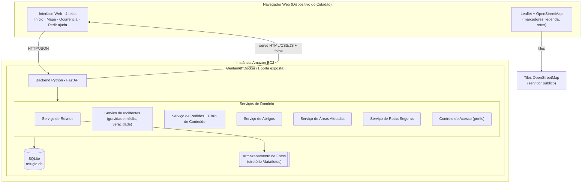
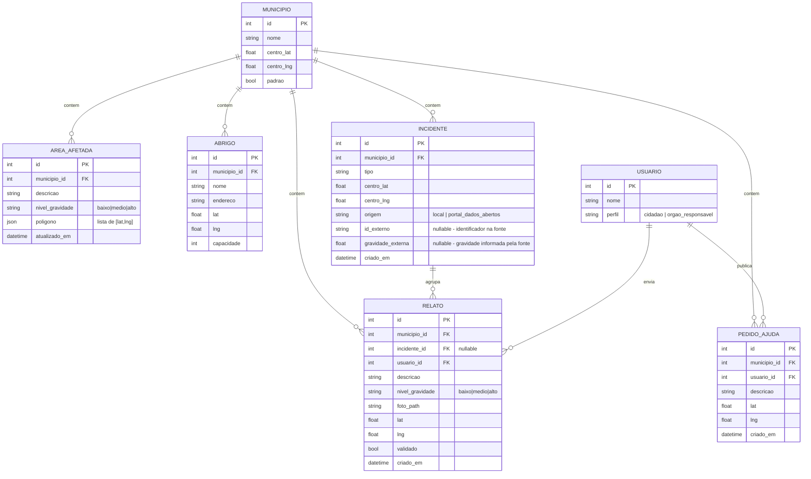

# Design Document

## Overview

O **Refúgio** é uma aplicação web responsiva de resposta a emergências desenvolvida em Python. O objetivo deste design é especificar um **protótipo demonstrável** — simples, pragmático e rápido de implementar — que atenda aos Requirements 1 a 15, sem recorrer a complexidade desnecessária (microserviços, filas, orquestração).

A aplicação conecta três grupos de informação:

1. **Informação geográfica de risco** — Áreas Afetadas, Abrigos e Rotas Seguras exibidas em um Mapa.
2. **Relatos da comunidade** — enviados por Cidadãos (descrição, gravidade, foto), agrupados em Incidentes com cálculo de Gravidade Média e Veracidade.
3. **Pedidos de Ajuda** — com Filtro de Conteúdo que bloqueia solicitações financeiras (golpes).

O design adota uma **arquitetura monolítica simples**: um único backend Python (FastAPI) que serve a Interface Web (HTML/CSS/JS responsivo), expõe uma API REST/JSON, persiste dados em SQLite e armazena fotos no sistema de arquivos. O Mapa é renderizado no navegador com Leaflet + OpenStreetMap. Todo o protótipo é empacotado em um único Container Docker e executado em uma Instância Amazon EC2, exposto à internet por uma porta.

Este nível de arquitetura é intencional: um processo, um banco, um container. Isso maximiza a velocidade de implementação e a facilidade de demonstração, que são os objetivos do protótipo.

### Mapeamento de Requisitos para o Design

| Requisito | Onde é atendido no design |
|-----------|---------------------------|
| R1 Áreas Afetadas | Mapa (Leaflet) + `GET /api/areas`; Serviço de Áreas |
| R2 Abrigos | Mapa + `GET /api/abrigos`; cálculo de distância |
| R3 Rotas Seguras | Serviço de Rotas (abordagem simplificada) + `GET /api/rotas` |
| R4 Envio de Relatos | Tela Ocorrência + `POST /api/relatos`; validação e armazenamento de foto |
| R5 Visualização de Relatos | Mapa + `GET /api/relatos`; filtro por gravidade |
| R6 Gestão por Órgão Responsável | Controle de acesso por perfil; endpoints protegidos |
| R7 Múltiplos Municípios | Parâmetro `municipio_id`; Ribeirão Preto como padrão |
| R8 Python | FastAPI (Python) |
| R9 Incidentes/Gravidade/Veracidade | Serviço de Incidentes; algoritmos de domínio |
| R10 Interface Web responsiva/acessível | Frontend responsivo + acessibilidade |
| R11 Pedido de Ajuda + Filtro | Tela Pedir ajuda + `POST /api/pedidos`; Filtro de Conteúdo |
| R12 Cores de gravidade no Mapa | Mapeamento gravidade→cor + legenda |
| R13 Container no EC2 | Dockerfile + execução em EC2 |
| R14 Conformidade com Mockups | Sistema de Design aplicado ao frontend |
| R15 Sincronização periódica dados.gov.br | Serviço de Integração de Dados Abertos + Agendador de 6h + Incidente_Externo (origem/`id_externo`); exibição no Mapa junto aos Relatos |

## Architecture

### Visão de Camadas



### Fluxo de Requisição Típico

1. O Cidadão acessa o endereço do protótipo no Navegador; o backend serve o HTML/CSS/JS responsivo (R10.1).
2. O frontend consome a API REST (`/api/...`) com JSON para carregar dados do Município selecionado (R7).
3. O Leaflet busca os *tiles* diretamente do OpenStreetMap e desenha marcadores/legenda a partir dos dados da API (R1, R2, R5, R12).
4. Envios (Relato, Pedido de Ajuda) são `POST` na API; o backend valida, aplica regras de domínio, persiste e responde com confirmação (R4, R11).

### Decisões de Arquitetura e Justificativas

- **FastAPI (Python)** — atende a restrição de Python (R8). Escolhido por ser leve, com validação de entrada embutida (Pydantic), documentação automática e servidor ASGI simples (Uvicorn). Flask seria igualmente válido; FastAPI foi preferido pela validação declarativa que reduz código de validação manual nos Requirements 4 e 11. *(Conteúdo sobre frameworks foi resumido e adaptado para o contexto do protótipo.)*
- **SQLite** — banco em arquivo único, sem servidor separado. Ideal para protótipo: zero configuração, cabe no mesmo container. Suficiente para o volume de uma demonstração. A camada de acesso é isolada para permitir troca futura por PostgreSQL.
- **Fotos no sistema de arquivos** — imagens gravadas em `/data/fotos` e servidas como arquivos estáticos. Evita complexidade de object storage (S3) no protótipo; o caminho da foto é guardado no banco.
- **Leaflet + OpenStreetMap** — biblioteca de mapas open-source que roda inteiramente no navegador, sem chave de API nem custo. Permite marcadores coloridos por gravidade, polígonos para Áreas Afetadas, *polylines* para rotas e legenda (R1, R5, R12).
- **Monólito em um container** — um processo, uma porta. Simplifica o deploy no EC2 (R13) e a demonstração.

## Components and Interfaces

### Backend (FastAPI) — Rotas HTTP

O backend expõe a Interface Web e a API. As rotas de página servem HTML; as rotas `/api` retornam JSON.

**Rotas de página (servem o frontend):**
- `GET /` → tela Início
- `GET /mapa` → tela Mapa
- `GET /ocorrencia` → tela Ocorrência (envio e visualização de Relato)
- `GET /pedir-ajuda` → tela Pedir ajuda
- `GET /static/*` e `GET /fotos/*` → assets e imagens

### Serviços de Domínio

Cada serviço é um módulo Python com funções puras sempre que possível, para facilitar teste e o property-based testing.

- **Serviço de Áreas Afetadas** — CRUD de Áreas Afetadas (limites geográficos + Nível de Gravidade). Consulta por Município (R1, R6.1).
- **Serviço de Abrigos** — CRUD de Abrigos (nome, endereço, localização, capacidade). Cálculo de distância Cidadão→Abrigo via fórmula de Haversine (R2, R6.2).
- **Serviço de Relatos** — validação (descrição, gravidade, foto obrigatórias), armazenamento de foto, associação de localização/data-hora, consulta com filtro por gravidade (R4, R5).
- **Serviço de Incidentes** — agrupamento de Relatos por ocorrência, cálculo de Gravidade Média, mapeamento de cor e classificação de Veracidade; recálculo ao receber novo Relato (R9, R12).
- **Serviço de Pedidos de Ajuda** — validação de descrição, aplicação do **Filtro de Conteúdo**, associação de localização/data-hora, listagem (R11).
- **Serviço de Rotas Seguras** — cálculo de rota evitando Áreas Afetadas (abordagem simplificada, ver "Algoritmos de Domínio") (R3).
- **Controle de Acesso** — distingue perfis **Cidadão** e **Órgão Responsável**; protege operações de gestão (R6.4).
- **Serviço de Integração de Dados Abertos** — executa a **Sincronização_de_Dados_Abertos** com o Portal Brasileiro de Dados Abertos (dados.gov.br): requisita os incidentes registrados, normaliza (parser) e importa como **Incidentes_Externos** de forma idempotente, registrando a origem como `portal_dados_abertos`. Disparado periodicamente pelo **Agendador** (a cada 6h) e, opcionalmente, por endpoint administrativo. Em caso de falha/indisponibilidade da fonte, degrada graciosamente (ver "Integração com Fontes de Dados Abertos") (R15).

### Frontend — Telas (conformidade com Mockups, R14)

Todas as telas replicam o Sistema de Design extraído dos Mockups de Referência:

**Tokens do Sistema de Design (R14.2–R14.7):**

| Token | Valor |
|-------|-------|
| Cor primária de ação | `#C9291C` |
| Fundo de tela | `#EFEFEC` |
| Superfícies (cards) | `#DEDEDB` |
| Cor de alerta | `#F6D9A6` |
| Laranja (gravidade média) | `#E8A028` |
| Vermelho (gravidade alta) | `#C9291C` |
| Verde | `#9DC48C` |
| Amarelo (gravidade baixa) | `#F2C94C` (amarelo do Sistema de Design) |
| Tipografia | Helvetica Neue, Arial, sans-serif |
| Botão (pílula) | `border-radius: 99px`, `min-height: 44px` |
| Card | `border-radius: 22px–28px` |
| Alvo de toque mínimo | `44px` |
| Nome exibido | "Refúgio" |

As quatro telas (R14.1):

- **Início** — título "Refúgio", card de alerta (fundo `#F6D9A6`), botão primário "Falar e pedir ajuda", atalhos "Avisar um problema", "Abrigos perto de mim", "Avisar família", "Ligar 193".
- **Mapa** — Leaflet em tela cheia, botões-pílula de filtro (Abrigos, Primeiros socorros, Vias interditadas, Reportes da comunidade), card de detalhe do elemento selecionado, legenda de cores de gravidade.
- **Ocorrência** — exibe/recebe Relato: selo de status, descrição, foto, contagem de confirmações; formulário de envio com descrição, seletor de gravidade e foto obrigatória.
- **Pedir ajuda** — título "Pedir ajuda", botão de gravar/opções rápidas, campo de descrição, localização, botão "Enviar pedido", aviso legal.

**Acessibilidade (R10.6–R10.8):** texto alternativo em elementos não textuais, navegação por teclado entre elementos interativos, e mensagem de navegadores compatíveis quando um recurso necessário não é suportado. Layout fluido entre 320px e 1920px (R10.3).

## Data Models

Entidades persistidas em SQLite. Identificadores inteiros autoincrementais, exceto onde indicado.



**Notas de modelo:**
- `nivel_gravidade` é um enum textual com valores `baixo`, `medio`, `alto` (R4.4).
- `Município` tem uma linha com `padrao = true` para Ribeirão Preto (R7.1).
- `perfil` do `Usuário` controla o acesso (R6.4). Para o protótipo, o perfil pode ser determinado por um cabeçalho/sessão simples; não há autenticação robusta.
- `foto_path` referencia um arquivo em `/data/fotos`; a imagem não é guardada no banco.
- `Incidente` não armazena Gravidade Média/Veracidade como colunas: esses valores são **derivados** dos Relatos associados em tempo de consulta (ou recalculados a cada novo Relato), garantindo consistência (R9.7). Um Incidente sem Relatos é omitido da exibição (R9.8).

### Incidente_Externo (R15)

Em vez de criar uma nova tabela, o conceito de **Incidente_Externo** é modelado reaproveitando a entidade `INCIDENTE` com campos de procedência:

- `origem` — enum textual `"local"` | `"portal_dados_abertos"`. Incidentes criados a partir de Relatos locais recebem `origem = "local"`; incidentes importados do Portal recebem `origem = "portal_dados_abertos"` (R15.4).
- `id_externo` — identificador do incidente na fonte (nullable; preenchido apenas para Incidentes_Externos).
- **Restrição de unicidade** em `(origem, id_externo)`: garante **idempotência** da importação — reimportar o mesmo incidente não cria registro duplicado (R15.5). A importação usa *upsert* por essa chave.
- `gravidade_externa` — gravidade própria informada pela fonte (nullable). Como um Incidente_Externo normalmente **não possui Relatos locais associados**, ele não participa do cálculo de Gravidade_Média/Veracidade baseado em Relatos. No protótipo, o tratamento é explícito:
  - A Gravidade_Média/Veracidade continuam derivadas **apenas** dos Relatos locais (um Incidente_Externo sem Relatos tem essas métricas indefinidas e NÃO é omitido pela regra R9.8, que se aplica a incidentes de origem local).
  - A cor exibida no Mapa para um Incidente_Externo usa a `gravidade_externa` quando informada (mapeada pela mesma função `cor_por_media`/`cor_por_nivel`); quando ausente, usa uma cor/estilo neutro distinto para sinalizar procedência externa.
- **Exibição no Mapa:** Incidentes_Externos aparecem no Mapa **junto** aos Relatos/Incidentes locais (R15.3), visualmente diferenciados pela procedência (ex.: selo "fonte: Portal de Dados Abertos"), de modo que o Cidadão identifique a origem oficial.

## API Endpoints

Resumo dos endpoints principais (JSON). Todos aceitam `municipio_id` (padrão: Ribeirão Preto).

| Método | Caminho | Descrição | Requisitos |
|--------|---------|-----------|------------|
| GET | `/api/municipios` | Lista Municípios disponíveis | R7.1, R7.3 |
| GET | `/api/areas?municipio_id=` | Lista Áreas Afetadas (com nível/cor) | R1.1–R1.3 |
| POST | `/api/areas` | Cadastra Área Afetada (apenas Órgão) | R6.1, R6.4 |
| GET | `/api/abrigos?municipio_id=&lat=&lng=` | Lista Abrigos (com distância se lat/lng) | R2.1–R2.4 |
| POST | `/api/abrigos` | Cadastra Abrigo (apenas Órgão) | R6.2, R6.4 |
| GET | `/api/relatos?municipio_id=&gravidade=` | Lista Relatos (filtro opcional) | R5.1–R5.3 |
| POST | `/api/relatos` | Envia Relato (multipart: descrição, gravidade, foto) | R4.1–R4.6 |
| POST | `/api/relatos/{id}/validar` | Valida Relato (apenas Órgão) | R6.3, R6.4 |
| GET | `/api/incidentes?municipio_id=` | Lista Incidentes com gravidade média, cor e veracidade | R9.1–R9.8, R12.4 |
| GET | `/api/rotas?origem=&destino=&municipio_id=` | Calcula Rota Segura evitando Áreas Afetadas | R3.1–R3.4 |
| POST | `/api/pedidos` | Publica Pedido de Ajuda (passa pelo Filtro de Conteúdo) | R11.1–R11.7 |
| GET | `/api/pedidos?municipio_id=` | Lista Pedidos de Ajuda | R11.8, R11.9 |
| GET | `/api/incidentes-externos?municipio_id=` | Lista Incidentes_Externos importados do Portal de Dados Abertos | R15.3, R15.4 |
| POST | `/api/admin/sincronizar-dados-abertos` | Dispara manualmente a Sincronização_de_Dados_Abertos (apenas Órgão; útil para demonstração) | R15.1–R15.6 |

**Respostas de erro padronizadas:** JSON `{ "erro": "<mensagem>", "campo": "<opcional>" }` com status HTTP apropriado (400 validação, 403 acesso negado, 404 não encontrado). As mensagens seguem o texto exigido pelos critérios (ex.: "a descrição é obrigatória", "a foto é obrigatória", "solicitações de pagamento não são permitidas por motivo de segurança", "acesso não autorizado").

## Algoritmos de Domínio

Os algoritmos centrais são funções puras, favorecendo testabilidade.

### Valor de Gravidade (R9.2)

```
valor_gravidade(nivel):
    "baixo" -> 1
    "medio" -> 2
    "alto"  -> 3
```

### Gravidade Média de um Incidente (R9.3)

```
gravidade_media(relatos):
    assume len(relatos) >= 1
    return soma(valor_gravidade(r.nivel) for r in relatos) / len(relatos)
```

### Mapeamento Gravidade Média → Cor (R12.4)

```
cor_por_media(media):   # media em [1.0, 3.0]
    if 1.0 <= media <= 1.5: return AMARELO
    if 1.5 <  media <= 2.5: return LARANJA   # #E8A028
    if 2.5 <  media <= 3.0: return VERMELHO  # #C9291C
```

### Cor por Nível (elementos individuais, R12.1–R12.3)

```
cor_por_nivel(nivel):
    "baixo" -> AMARELO
    "medio" -> LARANJA   # #E8A028
    "alto"  -> VERMELHO  # #C9291C
```

### Classificação de Veracidade (R9.4, R9.5)

```
veracidade(qtd_relatos):   # qtd_relatos >= 1
    if 1 <= qtd <= 2: return "baixa"
    if 3 <= qtd <= 5: return "media"
    if qtd >= 6:      return "alta"
```
Propriedade de monotonicidade: mais Relatos nunca reduz a Veracidade (R9.4).

### Filtro de Conteúdo (R11.3–R11.5)

```
TERMOS_BLOQUEADOS = ["pix", "chave pix", "transferencia", "ted", "doc",
                     "boleto", "cartao", "paypal", "dinheiro",
                     "pagamento", "conta bancaria"]

normalizar(texto):
    # minúsculas + remoção de acentos (NFD -> remove diacríticos)
    return sem_acentos(texto.lower())

contem_termo_bloqueado(descricao):
    norm = normalizar(descricao)
    for termo in TERMOS_BLOQUEADOS:
        if normalizar(termo) in norm_por_palavra(norm):
            return True
    return False
```
A correspondência é case-insensitive e insensível a acentos (R11.4). A comparação considera limites de palavra para os termos de palavra única (evita falsos positivos como "despix..."), e substring para expressões compostas ("chave pix", "conta bancaria"). Um Pedido com qualquer termo bloqueado é rejeitado (R11.5).

### Distância Cidadão → Abrigo (R2.4)

Fórmula de Haversine entre `(lat, lng)` do Cidadão e do Abrigo, retornando distância em metros.

### Rota Segura — Abordagem Simplificada (R3)

Para o protótipo, a Rota Segura usa uma abordagem simplificada em vez de um motor de roteamento completo:

1. Sobrepõe uma **grade de pontos** (grid) sobre a região do Município.
2. Marca como bloqueadas as células que caem dentro de qualquer polígono de Área Afetada.
3. Executa busca de caminho (A*/BFS) da origem ao destino sobre as células livres.
4. Converte o caminho em uma *polyline* exibida no Leaflet (R3.2).
5. Se não há caminho livre, retorna "nenhuma Rota Segura encontrada" (R3.3).
6. Ao adicionar/atualizar uma Área Afetada, a rota é recalculada na próxima consulta (R3.4).

**Limitações explícitas:** a grade não segue o traçado real das ruas (pode cortar quarteirões), não considera sentido de via, trânsito, nem elevação. É adequada para demonstrar o conceito "evitar áreas de risco", não para navegação real. Evolução futura: integrar um motor de roteamento sobre a malha viária (ex.: OSRM/GraphHopper).


## Integração com Fontes de Dados Abertos (Opcional)

O protótipo integra fontes públicas de dados de emergência. A integração principal e de **primeira classe** é com o **Portal Brasileiro de Dados Abertos (dados.gov.br)**, que atende ao Requirement 15. Outras duas fontes (Defesa Civil SP e Defesa Civil Alerta) permanecem **opcionais e desligadas por padrão**, servindo apenas como pontos de extensão.

Cada fonte é implementada como um **adaptador** com uma interface comum: `buscar_incidentes(municipio) -> list[IncidenteExterno]`, isolando o parser/formatação específicos da fonte do restante do sistema.

### Adaptador: Portal Brasileiro de Dados Abertos (dados.gov.br) — R15

Comportamento funcional previsto (não meramente opcional):

- **Agendamento periódico (R15.1):** a Sincronização_de_Dados_Abertos roda **a cada 6 horas**. O intervalo padrão de *polling* desta fonte é **21600 segundos (6h)**.
- **Importação (R15.2, R15.3):** a cada execução, o adaptador requisita ao Portal os incidentes registrados, normaliza o retorno e **acrescenta** os registros aos dados do Aplicativo como **Incidentes_Externos**, que passam a ser exibidos no Mapa **junto aos Relatos**.
- **Idempotência / deduplicação (R15.5):** cada Incidente_Externo é identificado pela chave composta **(origem + identificador externo)** = `(origem = "portal_dados_abertos", id_externo)`. A importação é **idempotente** (*upsert* por essa chave); executar a sincronização repetidamente com o mesmo conjunto de incidentes **não cria registros duplicados**.
- **Procedência / origem (R15.4):** todo incidente importado é gravado com `origem = "portal_dados_abertos"` (procedência **Portal_de_Dados_Abertos**), permitindo distingui-lo dos Incidentes locais no Mapa.
- **Resiliência / degradação graciosa (R15.6):** se o Portal estiver indisponível ou a requisição falhar (timeout, erro HTTP, payload inválido), o Aplicativo **mantém os dados existentes**, **continua operando normalmente** e **registra a falha em log**, sem interromper a sincronização agendada seguinte.
- **Configuração (R15.7):** mesmo sendo um comportamento previsto, a sincronização pode ser **habilitada/desabilitada por configuração**. Quando desabilitada, o Aplicativo **omite** as requisições ao Portal.

### Agendador (Scheduler) do Backend

Para um protótipo monolítico (um processo FastAPI), o disparo periódico usa um **agendador simples em processo**:

- Opção recomendada: **APScheduler** (`BackgroundScheduler`) configurado com um *interval trigger* de 6h, iniciado no *startup* da aplicação.
- Alternativa equivalente sem dependência extra: uma **thread em background** com um laço `sleep(intervalo)` (timer), adequada ao escopo de protótipo.
- O agendador só é iniciado quando a sincronização está habilitada por configuração (R15.7). O **gatilho principal** é o agendador de 6h; o endpoint administrativo (`POST /api/admin/sincronizar-dados-abertos`) é um gatilho **manual** auxiliar, útil para a demonstração.
- Para testabilidade, o agendador recebe o **relógio (clock) por injeção**, permitindo verificar o intervalo de 6h com um *clock* falso nos testes (ver Testing Strategy).

### Variáveis de Configuração

| Variável | Padrão | Descrição |
|----------|--------|-----------|
| `FONTE_DADOSGOVBR_HABILITADA` | `true` | Habilita a Sincronização_de_Dados_Abertos com o Portal (R15.7). |
| `FONTE_DADOSGOVBR_POLLING_SEGUNDOS` | `21600` | Intervalo de *polling* do Portal de Dados Abertos: **6 horas** (R15.1). |
| `FONTE_DADOSGOVBR_URL` | `https://dados.gov.br/...` | Endpoint do dataset de incidentes do Portal. |
| `FONTE_DEFESACIVILSP_HABILITADA` | `false` | Fonte opcional (Defesa Civil SP), desligada por padrão. |
| `FONTE_DEFESACIVILSP_POLLING_SEGUNDOS` | `21600` | Intervalo de *polling* (quando habilitada). |
| `FONTE_DEFESACIVILALERTA_HABILITADA` | `false` | Fonte opcional (Defesa Civil Alerta), desligada por padrão. |
| `FONTE_DEFESACIVILALERTA_POLLING_SEGUNDOS` | `21600` | Intervalo de *polling* (quando habilitada). |

Observação: apenas a fonte **dados.gov.br** é habilitada por padrão (comportamento previsto do R15); as demais permanecem opcionais/desligadas.


## Correctness Properties

*Uma propriedade é uma característica ou comportamento que deve ser verdadeiro em todas as execuções válidas de um sistema — essencialmente, uma afirmação formal sobre o que o sistema deve fazer. As propriedades servem como ponte entre especificações legíveis por humanos e garantias de correção verificáveis por máquina.*

As propriedades abaixo foram derivadas da análise de prework dos critérios de aceitação. Cada uma é universalmente quantificada e será implementada por um único teste baseado em propriedades (property-based test).

### Property 1: Gravidade Média está sempre nos limites e é a média aritmética

*Para qualquer* Incidente com uma lista não vazia de Relatos, a Gravidade_Média calculada é igual à soma dos Valores_de_Gravidade dividida pela quantidade de Relatos, e o resultado está sempre no intervalo [1,0, 3,0].

**Validates: Requirements 9.2, 9.3**

### Property 2: Veracidade é corretamente classificada e monotônica

*Para qualquer* quantidade de Relatos associados a um Incidente maior ou igual a 1, a Veracidade é "baixa" para 1 ou 2 Relatos, "média" para 3 a 5 Relatos e "alta" para 6 ou mais Relatos; e aumentar a quantidade de Relatos nunca reduz a Veracidade.

**Validates: Requirements 9.4, 9.5**

### Property 3: Gravidade Média mapeia para a Cor de Gravidade correta

*Para qualquer* valor de Gravidade_Média no intervalo [1,0, 3,0], a Cor_de_Gravidade resultante é amarela quando a média está entre 1,0 e 1,5, laranja quando é maior que 1,5 e até 2,5, e vermelha quando é maior que 2,5 e até 3,0.

**Validates: Requirements 12.4**

### Property 4: Cor por nível é consistente com a cor por média

*Para qualquer* Nível_de_Gravidade e qualquer quantidade de Relatos todos nesse mesmo nível, a Cor_de_Gravidade derivada da Gravidade_Média do Incidente é igual à Cor_de_Gravidade atribuída diretamente àquele Nível_de_Gravidade (amarelo para "baixo", laranja para "médio", vermelho para "alto").

**Validates: Requirements 12.1, 12.2, 12.3**

### Property 5: Recalcular após adicionar um Relato é consistente com calcular sobre a lista estendida

*Para qualquer* Incidente e qualquer novo Relato adicionado a ele, a Gravidade_Média e a Veracidade recalculadas são iguais aos valores obtidos aplicando as funções de cálculo diretamente sobre a lista de Relatos acrescida do novo Relato.

**Validates: Requirements 9.7**

### Property 6: O Filtro de Conteúdo detecta todo Termo Bloqueado independentemente de caixa e acento

*Para qualquer* Termo_Bloqueado e qualquer variação de maiúsculas/minúsculas e de acentuação desse termo inserida na descrição de um Pedido_de_Ajuda, o Filtro_de_Conteúdo identifica a presença do termo e o Aplicativo rejeita a publicação.

**Validates: Requirements 11.3, 11.4, 11.5**

### Property 7: Descrições sem Termos Bloqueados são aceitas pelo Filtro

*Para qualquer* descrição de Pedido_de_Ajuda construída sem conter nenhum Termo_Bloqueado, o Filtro_de_Conteúdo não acusa termo bloqueado e a publicação não é rejeitada por esse motivo.

**Validates: Requirements 11.3, 11.5**

### Property 8: Relatos inválidos são rejeitados

*Para qualquer* tentativa de envio de Relato sem descrição textual (vazia ou apenas espaços), sem foto, ou com Nível_de_Gravidade fora de {"baixo", "médio", "alto"}, o Aplicativo rejeita o Relato.

**Validates: Requirements 4.2, 4.3, 4.4**

### Property 9: Pedido de Ajuda sem descrição é rejeitado

*Para qualquer* tentativa de publicação de Pedido_de_Ajuda com descrição vazia ou apenas espaços, o Aplicativo rejeita a publicação.

**Validates: Requirements 11.2**

### Property 10: Consultas respeitam o Município e o filtro de gravidade

*Para qualquer* conjunto de dados e qualquer Município selecionado, todas as Áreas_Afetadas, Abrigos e Relatos retornados pertencem ao Município selecionado; e quando um filtro por Nível_de_Gravidade está aplicado, todos os Relatos retornados possuem o Nível_de_Gravidade selecionado.

**Validates: Requirements 1.1, 2.1, 5.1, 5.3, 7.2**

### Property 11: A distância ao Abrigo é não-negativa, nula na identidade e simétrica

*Para qualquer* par de coordenadas geográficas, a distância calculada é maior ou igual a zero, é zero quando as coordenadas são iguais, e é igual ao calcular em qualquer ordem dos pontos.

**Validates: Requirements 2.4**

### Property 12: A Rota Segura nunca atravessa uma Área Afetada

*Para qualquer* conjunto de Áreas_Afetadas e qualquer par origem/destino, se o Aplicativo retorna uma Rota_Segura, nenhum ponto dessa rota está contido em uma Área_Afetada; e se não existe caminho livre, o Aplicativo indica que nenhuma Rota_Segura foi encontrada.

**Validates: Requirements 3.1, 3.2, 3.3**

### Property 13: Operações de gestão exigem perfil de Órgão Responsável

*Para qualquer* usuário cujo perfil não seja Órgão_Responsável, uma tentativa de cadastrar Área_Afetada ou Abrigo é negada com mensagem de acesso não autorizado; para usuários com perfil Órgão_Responsável, a operação é permitida.

**Validates: Requirements 6.4**

### Property 14: A importação de Incidentes_Externos é idempotente

*Para qualquer* conjunto de Incidentes_Externos recebidos do Portal_de_Dados_Abertos, importar esse mesmo conjunto uma ou mais vezes resulta no mesmo estado de dados: cada Incidente_Externo, identificado pela chave composta (origem, id_externo), aparece exatamente uma vez, sem registros duplicados.

**Validates: Requirements 15.5**

## Error Handling

O tratamento de erros é padronizado e orientado às mensagens exigidas pelos critérios de aceitação.

- **Validação de entrada (400)** — campos obrigatórios ausentes ou valores inválidos. Respostas JSON com mensagem específica:
  - Relato sem descrição → "a descrição é obrigatória" (R4.2).
  - Relato sem foto → "a foto é obrigatória" (R4.3).
  - Gravidade inválida → mensagem listando os valores válidos "baixo", "médio", "alto" (R4.4).
  - Pedido de Ajuda sem descrição → "a descrição é obrigatória" (R11.2).
- **Filtro de Conteúdo (400/rejeição)** — Pedido com Termo Bloqueado → "solicitações de pagamento não são permitidas por motivo de segurança" (R11.5).
- **Acesso negado (403)** — operação de gestão por não-Órgão → "acesso não autorizado" (R6.4).
- **Ausência de dados (200 com mensagem)** — sem Áreas Afetadas / Abrigos para o Município → mensagem informativa na Interface Web (R1.3, R2.3).
- **Rota não encontrada (200 com mensagem)** — nenhuma Rota Segura livre entre origem e destino → mensagem "nenhuma Rota Segura foi encontrada" (R3.3).
- **Navegador incompatível** — quando o frontend detecta ausência de recurso necessário, exibe mensagem com os Navegadores Web compatíveis (R10.8).
- **Armazenamento de foto** — falha ao gravar o arquivo não deve deixar um Relato órfão; a persistência do Relato só é confirmada após a foto ser salva (transação lógica).
- **Mapas** — se os *tiles* do OpenStreetMap não carregarem, o Mapa exibe aviso e mantém a legenda e os marcadores sobre um fundo neutro.

## Testing Strategy

O protótipo adota uma **abordagem dupla**: testes baseados em propriedades para a lógica de domínio pura e testes de exemplo/integração/smoke para o restante.

### Property-Based Testing (lógica de domínio)

PBT é apropriado aqui porque os algoritmos de domínio (gravidade média, mapeamento de cor, veracidade, filtro de conteúdo, validações, distância, rota, controle de acesso) são funções puras com propriedades universais sobre um espaço de entrada amplo.

- **Biblioteca:** [Hypothesis](https://hypothesis.readthedocs.io/) (padrão de PBT para Python). Não implementar PBT do zero.
- **Iterações:** cada teste de propriedade roda no mínimo **100 iterações**.
- **Rastreabilidade:** cada teste é anotado com um comentário referenciando a propriedade do design, no formato:
  `# Feature: emergency-response-app, Property {número}: {texto da propriedade}`
- **Cobertura:** uma propriedade → um teste baseado em propriedades. As 14 propriedades da seção Correctness Properties são implementadas individualmente.

Geradores (strategies) principais:
- Relatos com `nivel_gravidade` sorteado em {baixo, médio, alto} e listas não vazias.
- Floats em [1,0, 3,0] para o mapeamento de cor, incluindo bordas (1,5 e 2,5).
- Textos com injeção de Termos Bloqueados em variações de caixa e acento (Property 6) e textos limpos construídos a partir de um alfabeto sem esses termos (Property 7).
- Coordenadas geográficas para distância e rota; conjuntos de polígonos de Áreas Afetadas sobre a grade.
- Conjuntos de Incidentes_Externos com chaves `(origem, id_externo)` sorteadas (incluindo repetições) para a Property 14 de idempotência da importação.

### Testes de Exemplo (unitários)

Focados em casos concretos e mapeamentos fixos:
- `valor_gravidade`: baixo→1, médio→2, alto→3 (R9.2).
- `cor_por_nivel`: três casos (R12.1–R12.3).
- Caso de Incidente sem Relatos é omitido da listagem (R9.8).
- Cadastro válido de Área Afetada e Abrigo por Órgão Responsável (R6.1, R6.2).
- Marcação de Relato como validado (R6.3).

### Testes de Integração

- Fluxo `POST /api/relatos` → persistência + foto salva + confirmação (R4.1, R4.5, R4.6).
- Fluxo `POST /api/pedidos` → filtro + persistência + confirmação (R11.1, R11.6, R11.7).
- Listagem de Pedidos de Ajuda para Cidadão e Órgão (R11.8, R11.9).
- Legenda de cores presente no Mapa (R12.5).

### Testes da Sincronização de Dados Abertos (R15)

A Sincronização_de_Dados_Abertos é testada com **mocks/stubs** do Portal (sem depender da disponibilidade real de terceiros):

- **Importação (R15.2–R15.4):** um stub do Portal retorna um conjunto de incidentes; verifica-se que os registros são importados como Incidentes_Externos, com `origem = "portal_dados_abertos"` e aparecem na listagem/Mapa junto aos Relatos.
- **Idempotência / deduplicação (R15.5):** além da Property 14 (property-based), um teste de exemplo executa a importação do mesmo conjunto **duas vezes** e confirma ausência de duplicatas pela chave `(origem, id_externo)`.
- **Degradação graciosa (R15.6):** o stub é configurado para falhar (exceção/timeout/HTTP 5xx/payload inválido); verifica-se que os dados existentes são preservados, o Aplicativo continua operando e a falha é registrada em log.
- **Agendamento de 6h (R15.1):** com um **relógio (clock) falso injetado** no agendador, avança-se o tempo simulado e confirma-se que a sincronização é disparada no intervalo de 21600s (6h) e omitida quando desabilitada por configuração (R15.7).
- **Endpoint administrativo:** `POST /api/admin/sincronizar-dados-abertos` dispara a sincronização sob demanda (restrito a Órgão_Responsável) e retorna o resultado da importação.

### Testes de Frontend / Conformidade com Mockups

- Verificação dos tokens do Sistema de Design (cores, tipografia, raio de botão 99px, raio de card 22–28px, alvo de toque 44px, nome "Refúgio") por teste de exemplo/snapshot (R14).
- Verificação manual de responsividade entre 320px e 1920px e de navegação por teclado (R10.3, R10.7). Esses aspectos de UI/acessibilidade não são adequados a PBT e dependem de inspeção manual com tecnologias assistivas para conformidade completa.

### Smoke Test (deploy)

- O container sobe e a Interface Web responde na porta exposta (R13.3).

## Empacotamento e Deploy do Protótipo

O protótipo é empacotado como um único Container Docker e executado em uma Instância Amazon EC2 (R13).

### Dockerfile (esboço)

```dockerfile
FROM python:3.12-slim
WORKDIR /app
COPY requirements.txt .
RUN pip install --no-cache-dir -r requirements.txt
COPY . .
# diretório de fotos e banco persistem em /data
VOLUME ["/data"]
EXPOSE 8000
CMD ["uvicorn", "app.main:app", "--host", "0.0.0.0", "--port", "8000"]
```

### Execução no Amazon EC2

1. Provisionar uma Instância EC2 (ex.: `t3.micro`) com Docker instalado.
2. No *Security Group*, liberar a porta de acesso (ex.: 80 ou 8000) para a internet (R13.3).
3. Construir e rodar o container:
   ```bash
   docker build -t refugio .
   docker run -d -p 80:8000 -v /opt/refugio/data:/data refugio
   ```
4. A Interface Web fica acessível em `http://<IP-público-da-EC2>/` por qualquer Navegador Web (R13.3).

**Simplicidade proposital:** um container, uma porta, um volume para dados/fotos. Sem orquestrador, balanceador ou pipeline de CI/CD, coerente com o escopo de protótipo.

## Considerações e Limitações do Protótipo

- **Autenticação simplificada** — o perfil (Cidadão vs Órgão Responsável) é tratado de forma leve (sessão/cabeçalho). Não há gestão robusta de identidade; evolução futura: login real e autorização por token.
- **Rota Segura por grade** — não segue o traçado real das ruas nem considera sentido de via/trânsito; demonstra o conceito de evitar áreas de risco. Evolução: motor de roteamento sobre malha viária (OSRM/GraphHopper).
- **Agrupamento de Relatos** — usa critério de mesmo tipo + proximidade por raio. Evolução: *clustering* geográfico mais sofisticado.
- **SQLite + fotos em disco** — adequado ao volume de demonstração; evolução: PostgreSQL + object storage (S3).
- **Atualização "em até 60s" (R1.4)** — no protótipo, o Mapa recarrega dados por *polling* periódico; evolução: *websockets*/push.
- **Sincronização com o Portal de Dados Abertos (R15)** — a sincronização com o dados.gov.br **a cada 6h** é um **comportamento previsto** do protótipo (habilitado por padrão, idempotente, com degradação graciosa). As outras fontes (Defesa Civil SP e Defesa Civil Alerta) permanecem **opcionais e desligadas por padrão**. Limitação: o formato/estrutura real dos datasets do Portal pode variar e exigir **adaptação do parser** do adaptador; o card de alerta da tela Início permanece ilustrativo. Evolução: parser robusto por dataset e integração com demais APIs oficiais.
- **Conformidade de acessibilidade (WCAG)** — o design prevê texto alternativo e navegação por teclado, mas a validação completa exige testes manuais com tecnologias assistivas e revisão especializada.
